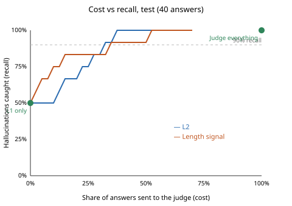

# RAG Hallucination Cascade

Catching made-up answers from a retrieval-augmented (RAG) system **without paying an LLM judge to
check every answer**: free rules first, a small trained classifier next, and the LLM judge only for
what the first two can't settle.

**Live demo:** *(link added after deployment)* · explore the results, browse every answer, and try
to get past the input guardrail.

## The problem

RAG systems give confident answers that the retrieved documents don't support. An LLM judge can catch
them, but at ~3 seconds and ~$0.007 per answer it's too slow and costly to run on everything, so teams
check a sample and hope. This project asks how much of the judge's quality you keep if it only sees
the answers cheaper checks can't settle.

## Result

On **40 held-out answers**, at a threshold chosen on training data before the test set was used:

| System | Sent to the judge | Hallucinations caught | Cost per 1,000 answers | Typical check time |
|---|---|---|---|---|
| Judge every answer | 100% | 100%\* | $7.08 | 2.65 s |
| **Cascade (rules → classifier → judge)** | **35%** | **92% (11 of 12)** | **$2.60** | **0.19 s** |
| Cascade with a length rule instead of the classifier | 45% | 92% | $3.27 | 0.10 s |
| Rules only | 0% | 50% | $0 | 0.06 s |

The test set is small: 95% intervals are 20–50% sent to the judge and 71–100% caught.
\*Partly by construction: the test reference uses the judge's label wherever the human labeller agreed with it.



The deliverable is the curve, not one number: every threshold is shown. Full write-up:
[`reports/cascade_results.md`](reports/cascade_results.md).

## How it works

```
question ──► L0 input guardrail (6 rules: prompt injection, jailbreaks)
                │
                ▼
         RAG system under test: 30 CUAD contracts, Qwen3 embeddings + FAISS, Mistral 7B (local)
                │  answer + the excerpts it used
                ▼
         L1 rules (free, ~0.07 s) ── hard evidence → FLAG · plain refusal → PASS
                │  unsure
                ▼
         L2 classifier (free, ~0.14 s) ── confident it's fine → PASS
                │  not sure
                ▼
         L3 LLM judge (Claude Sonnet 5.5, ~$0.007, ~3 s) ── decides
```

- **L1** fails an answer on hard evidence: it refused and then guessed anyway, quoted a number the
  excerpts never mention, or barely overlaps them. It passes plain "not in the text" refusals.
- **L2** is a logistic regression on 12 cheap signals (length, similarity to the excerpts, retrieval
  scores, …), trained on 217 answers the judge labelled. It never blocks an answer by itself: it only
  clears answers or passes them up. Only about half its flags were real, so letting it block would
  reject good answers.
- **L3** checks every claim in the answer against the excerpts the system was given.

## How the numbers were kept honest

- **Hallucinations were induced on purpose**, so about a third of answers are wrong: questions the
  contract can't answer, the right clause removed from retrieval, a clause from another contract
  planted, and a weaker model writing the answer. 320 answers in total.
- **The judge was checked against people.** 60 answers were labelled blind (the page never showed
  the judge's verdict). Blind agreement was low (67%, Cohen's κ 0.25), mostly from refusals being
  labelled inconsistently. The 19 disagreements were settled blind by a model from another family,
  which sided with the judge 13 times. After that, agreement was 93% (κ 0.85), and the judge missed no
  hallucinations. That figure is an upper bound; the blind κ is the independent one.
  [`reports/judge_agreement.md`](reports/judge_agreement.md)
- **A held-out test set, used once.** 40 answers were set aside before anything was built. Every
  threshold was picked on training data (using out-of-fold classifier scores), then read on test.
- **Baselines the classifier had to beat:** judge everything, rules only, and rules plus the single
  best signal (answer length).

## What didn't work, and what surprised me

- **The classifier didn't reliably beat a length rule at ranking answers** (test ROC-AUC 0.71 vs 0.80,
  intervals overlapping). Its value is cost: about 10 points fewer judge calls at the same recall.
  [`reports/l2_results.md`](reports/l2_results.md)
- **Hallucinated answers looked *more* like the contract, not less.** They reuse its wording while
  misreading it ("either party may audit" when only one can), so word overlap was useless (AUC 0.52)
  once the easy cases were gone. Embeddings measure topic, not truth; that's the judge's job.
- **Every missed hallucination was one the classifier cleared; most false alarms came from one
  over-eager L1 rule.** Those are the two dials to tune next.
- **The slowest answers get slightly slower** (95th percentile 3.5 s vs 3.2 s): answers that go to
  the judge pay for the cheap checks first. The cascade saves cost and the typical wait, not the tail.
- **The input guardrail catches phrasings, not intent:** 19 of 24 test attacks blocked, and all 5
  reworded attacks written afterwards got through. No real question was blocked.

## Limitations

- 40 test answers with 12 hallucinations: every test number has a wide interval.
- "Hallucination" here means a claim the retrieved excerpts don't support. An answer faithful to the
  wrong retrieved clause counts as supported; that is a retrieval failure, outside this evaluator.
- The classifier is trained on the judge's labels, so it is a cheap imitation of the judge, checked
  against human-reviewed labels on the test set.
- One contract corpus and one generator family. The method carries over; the trained weights and
  thresholds would need refitting.
- Latency was measured on one MacBook; cost uses the judge's API prices as billed.

## Quickstart: explore the results (3 commands)

The app reads committed data only: no models, database or API key.

```bash
git clone https://github.com/CodeSavitar/rag-hallucination-cascade && cd rag-hallucination-cascade
pip install -r app/requirements.txt
streamlit run app/streamlit_app.py
```

## Reproduce the whole pipeline

Needs the CUAD dataset (below), [Ollama](https://ollama.com) with `mistral` and
`mistral:7b-instruct-v0.3-q2_K`, and an Anthropic API key in `.env` (see `.env.example`) for the judge.
Judging all 320 answers costs about $2.30.

```bash
pip install -r requirements.txt
python src/build_index.py            # chunk and embed the 30 contracts
python src/build_seed_set.py         # 120 questions with induced failures, 40 held out
python src/build_extra_train_set.py  # 200 more training questions
python src/run_seed_set.py           # answer them (then --extra for the 200)
python src/l1_signals.py RUN_ID      # L1 on every answer of a run
python src/judge.py --all RUN_ID     # L3 judge (paid; guarded by a $15 cap in src/budget.py)
python src/l2_features.py && python src/baselines.py && python src/train_l2.py && python src/evaluate_l2.py
python src/sweep.py && python src/cascade_report.py && python src/export_app_data.py
```

New runs get new IDs; `src/query_logger.py` pins the two runs the reports use. The human labels behind
the test set are committed in `data/reference_labels.csv` and `data/human_labels.csv` (the labelling
page is `src/label_app.py`). `STATUS.md` is the task-by-task log; `KNOWLEDGE.md` records every decision
and dataset quirk.

## Data and attribution

The contracts and clause labels come from the **Contract Understanding Atticus Dataset (CUAD) v1**,
curated by [The Atticus Project](https://www.atticusprojectai.org/cuad) and released under
[CC BY 4.0](https://creativecommons.org/licenses/by/4.0/). The dataset itself is not included in this
repository; download it from the link above. Some files under `data/`, `reports/` and `app/data/`
quote short contract passages and clause labels from CUAD.

> Dan Hendrycks, Collin Burns, Anya Chen, Spencer Ball. *CUAD: An Expert-Annotated NLP Dataset for
> Legal Contract Review.* NeurIPS 2021 Datasets and Benchmarks. [arXiv:2103.06268](https://arxiv.org/abs/2103.06268)

Use of CUAD is also subject to The Atticus Project's
[privacy policy](https://www.atticusprojectai.org/privacy-policy) and
[disclaimer](https://www.atticusprojectai.org/disclaimer).
